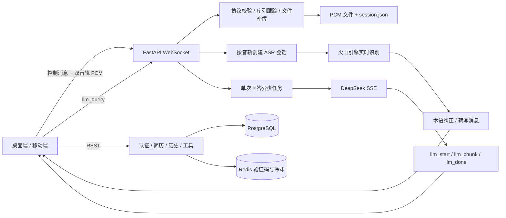

# AI 面试助手后端：技术实现与简历素材

本文用于帮助阅读者或 AI 理解项目的实际工程实现，并据此提炼简历项目经历。重点是业务问题、技术难点、设计取舍和代码依据，不是启动手册。

下文区分“代码已实现的能力”和“尚需验证的效果”。个人负责范围、项目时间、用户规模和性能收益无法仅从代码确认；写入简历前需由项目作者补充。

## 1. 项目背景与后端职责

项目面向技术面试中的实时辅助场景：客户端采集麦克风和系统声音，后端进行语音转写；客户端选择或提交问题后，后端调用大模型并逐段返回参考回答。同时提供邮箱登录、用户偏好、PDF / DOCX / TXT 简历文本解析、面试准备工具和面试历史保存。

文档格式转换功能已移除，后端不依赖 LibreOffice。简历上传保留文字提取能力，不进行 PDF 与 Word 格式互转。

后端的主要工程工作集中在三条链路：

1. **音频接入与存储**：管理双音轨会话，接收二进制 PCM 帧，跟踪序列缺口，通过完整文件补传和 SHA-256 校验生成最终录音文件。
2. **实时识别与生成**：异步对接火山引擎 ASR，处理静音断句和重连，再将 DeepSeek 的流式输出转换为客户端可消费的 WebSocket 消息。
3. **业务数据管理**：通过 REST API 实现认证、用户偏好、简历生成结果和面试记录的持久化。

这里的后端不负责操作系统音频采集；采集由桌面端和移动端完成。实时转写也不会在服务端自动触发回答，回答由客户端发送 `llm_query` 启动。

## 2. 技术栈与整体结构

| 技术 | 在项目中的实际用途 |
| --- | --- |
| Python 3.12、FastAPI、Uvicorn | 提供 REST 接口与长连接音频入口 |
| asyncio、WebSocket | 拆分音频发送、识别接收、静音监控和回答推送任务 |
| Pydantic | 校验控制消息，兼容部分 snake_case / camelCase 字段 |
| httpx、HTTP/2、SSE | 调用 DeepSeek，解析上游流式响应并转发 |
| SQLAlchemy Async、PostgreSQL | 持久化用户、Token、简历生成结果和面试历史 |
| Redis | 保存验证码、过期时间与发送冷却状态 |
| SQLite、内存 Redis 替身 | `LOCAL_DEV=true` 时提供本地开发存储 |
| pdfplumber、Python 标准库 ZipFile / ElementTree | 从 PDF、DOCX 简历提取文字；TXT 使用标准文本解码 |
| Docker Compose | 编排后端、PostgreSQL 和 Redis |

代码按入口、业务服务和数据模型拆分：

| 位置 | 责任 |
| --- | --- |
| [app/main.py](app/main.py) | 加载环境变量、注册路由、管理数据库启动与关闭 |
| [app/routers/audio.py](app/routers/audio.py) | WebSocket 会话编排，连接协议、ASR 与 LLM |
| [app/services/audio_service.py](app/services/audio_service.py) | 二进制协议解析、轨道接收、补传校验、音频元数据 |
| [app/services/stt_streaming.py](app/services/stt_streaming.py) | 火山实时 ASR 连接、收发任务、断句与重连 |
| [app/services/llm_service.py](app/services/llm_service.py) | 模型请求、提示词构造、SSE 解析与 HTTP 客户端复用 |
| [app/services/asr_text_corrector.py](app/services/asr_text_corrector.py)、[tracks](app/services/tracks) | 技术术语纠正与语言赛道配置 |
| [app/routers/auth.py](app/routers/auth.py)、[auth_service.py](app/services/auth_service.py) | 验证码、密码、Token 与用户接口 |
| [app/models/db_models.py](app/models/db_models.py)、[db.py](app/db.py)、[redis.py](app/redis.py) | 数据模型、异步会话与存储切换 |

## 3. 核心工程设计

### 3.1 双音轨二进制协议与完整文件补传

**要解决的问题**：麦克风和系统声音需要独立识别；网络拥塞时，实时音频可能出现缺帧，但结束后的录音文件仍需要能够校验完整性。

**具体实现**：

- 使用 `audio.capture.v1` 协议，在同一条 WebSocket 上传输 JSON 控制消息和二进制音频包。
- 二进制包由 **44 字节包头 + PCM 数据**组成。包头包含协议版本、包类型、音轨来源、会话 UUID、序列号、采集时间偏移和载荷长度；包头采用大端序，PCM 采用小端序。
- 区分 `mic` / `system` 两个来源，以及 `realtime` / `backfill` 两种传输类型；每条轨道分别维护实时与补传序列。
- `AudioPacketHeader.decode()` 校验包头、协议版本、来源、序列号、时间偏移和长度。`SequenceTracker` 拒绝落后的序列号，并记录向前跳号造成的缺口。
- 服务端按每收到 10 个有效音频包的节奏发送 `chunk_ack`，携带接收字节数、序列进度和缺口信息。
- 实时数据先写入 `.realtime.pcm.part`，写入时将显式 `flush` 的调用频率限制为约每秒一次。
- 停止采集后，客户端通过 `file_start → backfill 数据包 → file_end` 上传完整文件。服务端验证字节数和 SHA-256 后，将临时文件替换为对应轨道的最终 `.pcm` 文件。
- 只有预期的全部音轨完成补传校验，`session_complete` 才能将会话标为完成；中途断开会保存 `incomplete` 状态。

**设计取舍**：实时传输优先服务当前识别，最终文件完整性依赖结束后的全量补传。序列号用于发现缺口，不代表已经实现按缺失分片重传或跨连接断点续传；ACK 也不能证明其之前的所有包都连续到达。

**代码依据**：[AudioPacketHeader / SequenceTracker / TrackReceiver / V1AudioSession](app/services/audio_service.py)、[控制消息模型](app/models/schemas.py)、[协议说明](../mobile/docs/AUDIO_PROTOCOL_V1.md)。

**可提炼能力**：应用层协议设计、双通道数据路由、传输完整性校验、会话生命周期管理，以及实时性与最终文件完整性之间的取舍。

### 3.2 异步 ASR 流水线、静音断句与重连

**要解决的问题**：客户端持续产生音频，而上游 ASR 的收发速度与结果返回时机不固定。长时间识别还需要处理停顿、句子结束和连接重建。

**具体实现**：

- 为麦克风和系统声音分别创建 `StreamingASRSession`，连接火山引擎双向流式识别接口。
- 每个 ASR 会话拆分为 `_send_loop()`、`_recv_loop()`、`_silence_monitor()` 三个异步任务，避免将音频接收、上游发送和识别结果等待串成一条阻塞链。
- `feed()` 使用容量为 32 的发送队列进行非阻塞入队；队列满时丢弃该次待发送帧，以限制上游发送积压。
- 对系统音频使用前 32 字节全零快速检测；对麦克风使用抽样 RMS 能量检测，并要求连续两帧达到阈值后更新有声时间，减少短促噪声对断句的干扰。
- 静音监控每 200ms 检查一次。当已有识别文本且静音达到 1.2 秒时，发送最终转写标记并关闭当前上游连接。
- 后续音频帧触发按需重连。重连期间缓存收到的帧，连接成功后尝试回放；设置 8 秒连接超时和失败重试间隔。
- 接收端去除重复文本，经过术语纠正后，通过 `transcription` 消息返回 `text`、`is_final` 和 `source`。

**设计取舍**：有界队列控制积压，但 ASR 链路可能丢帧；重连缓存回放仍受发送队列容量影响，不能表述为“识别音频零丢失”。文件补传保证的是最终录音的可校验性，不会自动修复已经返回的识别文本。

**代码依据**：[StreamingASRSession](app/services/stt_streaming.py)、[audio_stream / _transcription_sender](app/routers/audio.py)。

**可提炼能力**：异步 I/O 编排、有界队列、流式语音接入、静音检测、超时与连接恢复。

### 3.3 可取消的流式问答与请求关联

**要解决的问题**：用户可能在上一条回答尚未结束时提交新问题。如果简单地并行推送，旧回答的内容或结束事件可能落到新回答上；等待全文生成又会延迟内容展示。

**具体实现**：

- 客户端在音频会话建立后发送 `llm_query`，提交问题、回答语言、技术赛道及可选的 `request_id`。
- 每条 WebSocket 连接维护当前回答任务。收到新问题时取消旧任务，并立即发送新请求的 `llm_start`。
- 新协议通过 `request_id` 关联开始、增量和结束消息，让客户端能够过滤旧请求的迟到事件；旧客户端未提供 ID 时，服务端会有限等待旧任务退出。
- `LLMService` 复用 `httpx.AsyncClient(http2=True)`，以 SSE 接收 DeepSeek 输出，解析 `data:`、内容增量和结束标记。
- 后端使用独立发送任务，将上游内容转成 `llm_chunk`，携带 `delta`、`chunk_index`、`request_id` 和时间戳。
- 完成后发送包含完整回答的 `llm_done`；取消或失败也尝试发送结束消息，供客户端收尾。
- 建立会话时可预热模型服务连接；通过 `config.llm` 覆盖模型、最大输出 token 数和启用状态。

**设计取舍**：采用“优先处理最新问题”的交互方式，旧回答允许被截断。请求 ID 为客户端提供隔离依据，不能仅凭服务端字段就宣称端到端竞态已全部消除。

**代码依据**：[audio_stream / _llm_single](app/routers/audio.py)、[LLMService.stream_answer / warmup](app/services/llm_service.py)。

**可提炼能力**：第三方模型流式集成、SSE 到 WebSocket 的协议适配、异步任务取消、请求关联和流式 UI 事件设计。

### 3.4 面向技术面试的术语纠正与赛道配置

**要解决的问题**：技术面试包含大量英文缩写、字母拼读和中英文混合术语，通用 ASR 的输出可能偏离实际技术名词。

**具体实现**：

- 将 JavaScript、Python、Java、C#、C++、Go 六个赛道分别配置在独立模块中，同时维护公共术语。
- 每个赛道通过 `TRACK` 字典提供术语及其常见误识别变体、系统提示词补充等配置。
- 纠正器加载公共术语和本次纠正调用指定赛道的术语，展开字母拼读、空格和部分符号变体，并按变体长度降序匹配，优先处理较长术语。
- 在向客户端发送转写前，以及向模型提交问题前，执行术语字符串替换。
- 模型系统提示按赛道和中英文回答要求构造，并要求先识别问题中的术语错误，再以候选人口吻组织回答。

**设计取舍**：这是规则与提示词结合的领域适配。维护词表可以覆盖已知误识别情况，但需要通过样本评估误替换；代码中虽存在拼音模糊匹配函数，当前主流程没有调用，不能写成已启用的纠错能力。

**代码依据**：[tracks/__init__.py](app/services/tracks/__init__.py)、[correct_asr_text / _build_lookup](app/services/asr_text_corrector.py)、[build_system_prompt](app/services/llm_service.py)。

**可提炼能力**：配置化领域适配、规则归一化、可扩展词表组织，以及基于业务场景的提示词设计。

### 3.5 认证、短期状态与业务数据持久化

**要解决的问题**：验证码具有短生命周期，而账户、登录凭据和面试记录需要持久化；简历和历史数据还需要按用户查询。

**具体实现**：

- Redis 保存 6 位邮箱验证码，TTL 为 5 分钟；通过 `SET NX EX` 建立 30 秒发送冷却，验证成功后删除验证码与冷却键。
- 支持验证码登录、验证码注册和密码登录。密码采用随机盐与 PBKDF2-HMAC-SHA256（100,000 次迭代）派生后保存。
- 登录签发有效期为 15 天的 Token；数据库保存 Token 的 SHA-256 摘要，校验时重新计算摘要并检查有效期。该实现使用数据库查询，不是 JWT。
- 受保护 REST 路由通过 FastAPI 依赖解析 `Authorization: Bearer ...`，得到邮箱后执行用户范围内的查询。
- SQLAlchemy 提供异步数据库会话；`users`、`tokens`、`resumes`、`interviews` 四张表分别保存账户、凭据、简历生成结果和面试历史。
- 面试历史由客户端提交完整对话，后端序列化为 JSON 文本保存，并提供列表、详情和清空接口。
- `LOCAL_DEV=true` 时切换到 SQLite 与内存验证码存储，减少本地开发依赖；未显式启用时使用 PostgreSQL / Redis 路径。

**设计取舍**：验证码与持久业务数据分开存储；数据库 Token 便于服务端查询有效性，但每次验证需要查询数据库。按邮箱隔离适用于已接入认证的 REST 数据接口，不代表整个实时系统已经具备完整的多租户隔离。

**代码依据**：[认证路由](app/routers/auth.py)、[认证服务](app/services/auth_service.py)、[数据模型](app/models/db_models.py)、[历史接口](app/routers/interview.py)、[Redis 实现](app/redis.py)。

**可提炼能力**：认证流程、TTL 与原子条件写入、凭据摘要存储、依赖注入、异步 ORM 和用户数据访问范围控制。

### 3.6 简历文本解析与面试准备工具

这部分可作为完整产品能力的补充，简历篇幅有限时优先保留前面的实时链路设计。

- **简历文本解析**：桌面工作区的 `/api/workspace/resumes/upload` 接收不超过 10 MB 的 PDF、DOCX 或 TXT。PDF 使用 `pdfplumber`；DOCX 通过标准库读取 `word/document.xml`；TXT 支持 UTF-8 与 GB18030。文件解析在线程池中运行，提取到的文字按用户保存为不可变简历版本。扫描件没有 OCR，无法提取文字时提示改用粘贴文本。
- **面试准备工具**：`/api/workspace/tools/{tool}` 提供自我介绍、项目讲述、岗位分析和答题练习。请求携带真实简历、目标岗位及问题材料，由 `workspace_llm.complete_text()` 调用模型；缺少信息时要求明确标注，不编造经历或成果。
- **保留的旧简历接口**：`/api/resume` 路由仍提供 PDF 解析与自我介绍生成，供旧客户端兼容；桌面端的简历版本与准备工具使用工作区接口。

**代码依据**：[工作区简历与工具路由](app/routers/workspace.py)、[PDF 文本解析](app/services/resume_service.py)、[准备任务模型调用](app/services/workspace_llm.py)、[旧简历路由](app/routers/resume.py)。

## 4. 可供简历选用的表述

以下表述描述代码已体现的工作内容。作者应按本人实际承担的模块选用，不能由仓库内容推断“独立完成”“主导团队”或具体任职时间。

**项目名称**：AI 面试助手——实时语音识别与流式问答后端

**项目描述**：基于 FastAPI 构建面向桌面端与移动端的面试辅助服务，接入麦克风和系统双音轨，集成火山实时 ASR 与 DeepSeek 流式问答，并提供账户认证、简历处理和面试记录管理。

**偏 Python 后端 / 实时系统方向，可选以下 3～4 条：**

- 设计双音轨 WebSocket 传输协议，通过会话标识、独立序列跟踪和缺帧反馈管理实时 PCM 数据，并结合全量补传、长度及 SHA-256 校验完成最终录音文件的完整性验证。
- 基于 asyncio 拆分 ASR 音频发送、结果接收与静音监控任务，采用有界队列、麦克风 RMS 检测、静音断句和按需重连机制，处理持续音频流与上游识别服务的异步协作。
- 实现 DeepSeek SSE 到 WebSocket 的流式转发，以请求 ID 关联回答生命周期，结合任务取消和增量事件推送，支持用户在生成过程中切换问题。
- 使用 SQLAlchemy Async 与 PostgreSQL 管理账户和面试数据，以 Redis TTL、原子条件写入实现验证码有效期及发送冷却，并提供基于 Token 的 REST 认证与用户范围查询。

**偏 AI 应用工程方向，可将一条替换为：**

- 构建覆盖六类编程语言赛道的术语词表与提示词配置，在转写展示和模型输入阶段执行领域术语纠正，并支持中英文回答及模型参数配置。

这些表述中的“支持”“实现”是功能事实；若要改成“降低延迟”“提升准确率”“提高吞吐量”，需先补充对应测量结果。

## 5. 面试展开时值得讲清楚的取舍

| 可能的追问 | 可以围绕代码展开的回答 |
| --- | --- |
| 为什么同一连接混合 JSON 和二进制？ | JSON 表达控制事件，二进制直接承载音频；包头负责会话和轨道归属，避免把音频转成 JSON 字符串传输。 |
| 有 ACK 为什么还要补传？ | ACK 提供进度和缺口可见性，实时链路容许缺帧；最终文件用完整补传和哈希校验确认，二者目标不同。 |
| 为什么将 ASR 拆成多个任务？ | 音频产生、网络发送、识别返回和静音计时拥有不同节奏，用队列连接各阶段，并集中管理取消与关闭。 |
| 队列满了怎么办？ | 当前 ASR 发送队列丢弃待入队帧，限制积压；这是明确的实时性取舍，不能承诺转写无损。 |
| 新问题如何避免混入旧回答？ | 取消旧任务，并让所有回答事件携带请求 ID，由客户端过滤迟到消息；取消与网络发送之间仍需要处理时序。 |
| 为什么词表还需要赛道划分？ | 不同技术方向有不同术语和误识别变体，公共词表与赛道配置组合可以缩小纠正范围，也便于维护。 |
| 模型是否会记住整场对话？ | 当前每次请求只构造系统提示和本次问题；历史保存与模型上下文是独立功能，尚未接入多轮记忆。 |

## 6. 量化素材：已有参数与待补证据

代码中的参数可以说明设计规模，但不能充当效果指标：

| 可从代码确认的参数 | 正确含义 |
| --- | --- |
| 16 kHz、16 bit、单声道、40ms / 1,280 字节 | 客户端协议约定的每轨音频格式；ASR 上游配置固定为 16 kHz 单声道 PCM16 |
| 44 字节包头 | 应用层二进制包头长度，不是网络总开销 |
| 32 个 ASR 待发送帧 | 发送队列容量，不是并发用户数 |
| 1.2 秒静音阈值 | 断句策略参数，不是端到端转写延迟 |
| 六个语言赛道 | 配置覆盖的技术方向，不是六个模型或六个 Agent |
| 5 分钟验证码有效期、30 秒发送冷却 | 认证策略，不是可用性或吞吐量指标 |

如希望把简历写成“问题—方案—效果”，建议由项目作者补充以下证据：

| 待补指标 | 建议验证方式 |
| --- | --- |
| 转写延迟 | 使用统一计时基准，记录音频事件到客户端收到对应文本的耗时，区分中间结果与最终结果，报告样本数及 P50 / P95。 |
| 回答首段延迟 | 记录 `llm_query` 到首个非空 `llm_chunk` 的耗时，固定模型和问题集合，区分冷连接与预热连接。 |
| 术语纠正效果 | 用带人工标注的技术面试语料，对比纠正前后的术语命中率，并统计误替换率。 |
| 补传完整性 | 模拟实时缺帧，完成补传后比较客户端原始文件和服务端最终文件的长度与 SHA-256。 |
| 切换问题的正确性 | 连续提交带不同请求 ID 的问题，检查客户端是否出现旧内容进入新回答、错误结束或残留任务。 |
| 并发能力 | 先解决下节所述全局状态和认证问题，再用固定音轨数、时长和负载测试资源占用及错误率。 |

当前仓库未提供可作为简历依据的压测报告、准确率对比或延迟基准。源码注释中的耗时估计也不能直接作为已验证收益。

## 7. 写简历时必须保留的实现边界

以下是避免夸大项目的事实边界，不应转写为已完成的成果：

- **没有向量 RAG / 面试情报押题链路**：桌面端按用户选择提交岗位、简历快照及有限的最近对话上下文；简历文本解析和上下文注入不等同于向量检索或知识库。
- **没有模型训练或多 Agent 编排**：项目主要实现外部模型接入、规则处理、提示词配置和实时服务编排。
- **没有高并发或完整多租户证明**：转写队列使用模块级全局状态；用户的实时会话不能据此宣称已实现严格隔离。WebSocket 音频入口当前也未接入与 REST 相同的 Token 验证。
- **没有端到端零丢帧保证**：ASR 队列存在丢帧策略；全量文件补传与实时转写结果是两条不同的完整性边界。当前代码还会按来源将收到的音频载荷送入 ASR，未区分实时包和补传包。
- **没有完整的计费或配额强制执行**：存在客户端上报扣时接口及用户剩余时长字段，但实时入口未据此建立强制准入与计费闭环。
- **没有已启用的拼音模糊纠正**：应以执行路径为准，不以函数名、文件名或注释作为功能完成的证据。
- **没有完整迁移与性能验证体系的依据**：数据库启动使用 `create_all` 建表；依赖中包含 Alembic 和 pytest，不代表已经编写了迁移脚本或后端自动化测试集。

供 AI 提炼时，优先从第 3 节提取技术事实，从第 4 节选择简历表述，并用第 6、7 节约束量化和能力范围。重点呈现实时协议、异步任务、故障处理和流式模型集成；不要将设计目标写成经过验证的结果。
