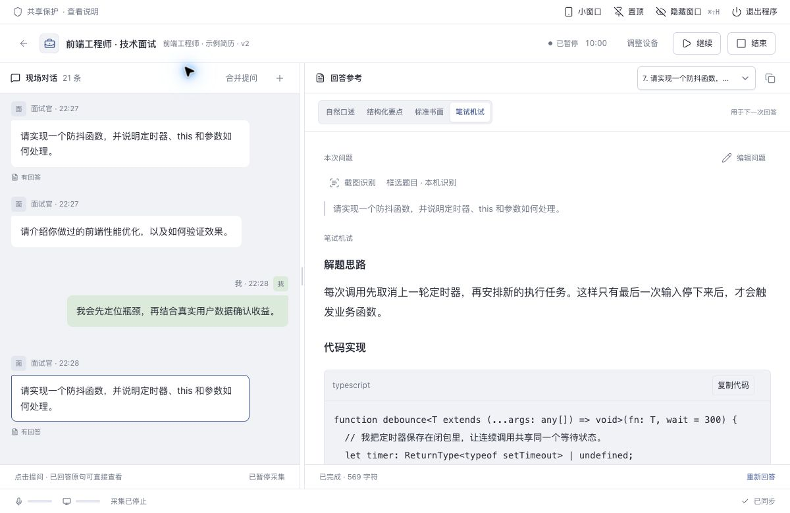
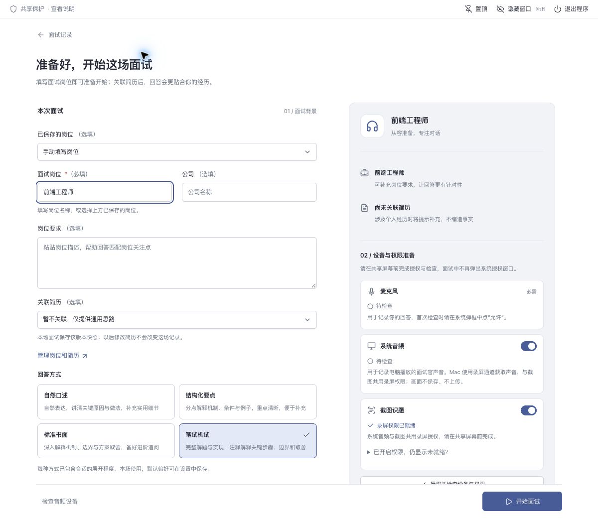
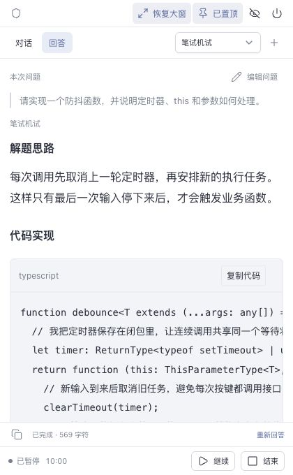
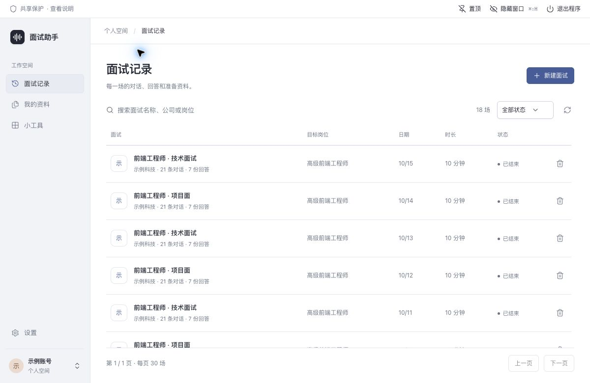

# AI 面试助手 · 桌面端

把面试准备、实时对话、回答参考和历史复盘放在同一个工作区。支持 **Mac Apple 芯片（arm64）** 与 **Windows x64**；实时面试以点击问题生成回答为主，避免后续对话打断正在阅读的答案。

本文对应 0.5.23。截图来自真实界面的本地演示数据，不含真实账号、简历或面试记录。



## 主要功能

| 场景 | 功能 |
| --- | --- |
| 账号 | 邮箱验证码登录、密码登录、注册、重设密码；错误提示跟随对应输入项 |
| 我的资料 | 简历上传与版本管理、目标岗位及要求、准备资料；支持编辑与删除 |
| 准备面试 | 选择岗位、关联简历版本、回答方式、音频来源；开始前检查权限和设备 |
| 实时对话 | 麦克风与系统音频分轨转写、逐句更新、手动修正与拆句、勾选多句合并提问 |
| 回答参考 | 流式生成、反复编辑问题后重新回答、深入补充、代码注释与复制、历史答案选择 |
| 截图识题 | 框选题目、本机中英文 OCR、编辑识别结果，提交后直接生成回答 |
| 小窗口 | 竖屏单栏、自动置顶、对话/回答切换、四种回答方式、补充问题、暂停与结束 |
| 面试记录 | 搜索、状态筛选、分页、对话与回答详情、复盘、文本导出、删除 |
| 小工具 | 自我介绍、项目经历梳理、岗位准备清单、回答精炼 |
| 设置 | 回答偏好、主题与字号、音频设备与权限、账户设置 |

不包含文档格式转换，不需要安装 LibreOffice。简历文件解析在后端完成。

## 从准备到结束

### 1. 准备资料与权限

先在「我的资料」添加简历和岗位，再进入「新建面试」。**面试岗位必填**；公司、岗位要求和简历可选。关联的是当时的简历快照，以后修改简历不会改写旧面试。

在共享屏幕之前完成「授权并检查设备与权限」：

- 麦克风是必需项。首次使用需在操作系统弹框中允许。
- 需要记录电脑播放的面试官声音时，打开系统音频开关，并选择会议软件实际使用的输出或输入路由。
- 需要截图时，提前开启截图识题并完成录屏授权。面试中不临时弹出申请权限的流程。
- 没有先检查就点开始时，应用会先检查必填项和权限；未就绪时留在准备页处理。



### 2. 点击原句，生成回答

左侧对话持续更新，右侧回答独立显示。点击一句生成对应回答；同一问题和同一回答偏好已有答案时，点击会打开已有结果。

一句问题分成了几个气泡时，点「合并提问」，逐条勾选，再点「合并回答」。选中项同时显示**勾号、底色和边框**，底部显示已选句数；再次点击即可取消。生成请求接受后退出多选。

识别不准确时有两个入口：

- 气泡下的「修正 / 拆句」：修正对话原文，或按手动换行拆成多个气泡。
- 回答上方的「编辑问题」：修改本次提问，再重新生成；可以反复编辑，不会只有一次机会。原始对话不因此被改写。

补充问题可直接输入，也可截图识别。先核对识别文本，再点「提交并回答」；问题会进入对话并立即请求答案。截图取消不会清空已有文字。

### 3. 选择适合的回答方式

| 方式 | 适合用途 |
| --- | --- |
| 自然口述 | 用自然语言讲清原因、做法和实用细节，便于现场组织表达 |
| 结构化要点 | 分点解释机制、条件与例子，快速找到重点和可补充内容 |
| 标准书面 | 深入解释原理、边界与方案取舍，为进阶追问准备材料 |
| 笔试机试 | 解题思路、完整实现、丰富代码注释、复杂度及边界讨论 |

切换方式应用于**下一次生成**，不会重写旧答案。正在生成或编辑问题时，先停止/完成当前操作再切换。答案里的代码可单独复制；注释帮助解释实现，但仍需核对题意与运行结果。

### 4. 小窗口：把空间留给回答

面试中点击顶部「小窗口」。同一场面试缩成竖屏窗口，采集与生成继续；自动置顶。恢复大窗口时还原原先的位置、大小和置顶选择。

| 区域 | 操作 |
| --- | --- |
| 窗口栏 | 恢复大窗、隐藏、退出；小窗口置顶不可单独关闭 |
| 工作栏 | 对话 / 回答、回答方式、`＋` 补充问题（支持截图） |
| 内容区 | 只滚动当前对话或回答；切换回来保留阅读位置 |
| 回答底栏 | 复制、生成进度、停止或重新回答 |
| 会话底栏 | 状态、时长、暂停/继续、结束 |

调整音频设备、查看答案版本等低频操作请恢复大窗口。小窗口仍保留四种回答模式，不用为了换模式恢复大窗。

| 阅读答案 | 勾选合并提问 |
| --- | --- |
|  |  |

### 5. 暂停、结束与复盘

暂停停止采集，但保留当前面试；恢复大窗口后可在「调整设备」修改来源和设备，再继续。结束会停止音频并保存记录，**已结束的面试不能继续生成现场答案**，可以查看、导出和生成复盘。

面试记录页的标题、搜索筛选和表头保持可见，列表单独滚动，分页在列表下方。保存失败时保留提示和本机待同步副本，先重试同步，勿通过清空应用数据解决。



## 窗口与快捷操作

- 顶部「置顶」控制大窗口；小窗口自动置顶，恢复大窗后沿用进入前的选择。
- 「隐藏窗口」暂时隐藏主窗口及回答浮窗。快捷键或菜单栏/托盘可恢复。
- 「退出程序」与关闭主窗口会先停止采集、保存草稿并退出；保存异常时会给出处理选择。关闭回答浮窗不等于退出整个程序。
- Mac 默认不显示 Dock 图标；菜单栏保留恢复与退出入口。Windows 使用系统托盘。

| 操作 | Mac | Windows |
| --- | --- | --- |
| 隐藏 / 恢复窗口（全局） | `⌘⇧H` | `Ctrl+Shift+H` |
| 面试记录 / 我的资料 / 小工具 | `⌘1 / ⌘2 / ⌘3` | `Ctrl+1 / Ctrl+2 / Ctrl+3` |
| 设置 | `⌘,` | `Ctrl+,` |
| 回答浮窗 | `⌘B` | `Ctrl+B` |

页面快捷键在文本输入、弹窗中不抢按键；面试中的导航仍需完成结束保护。小窗口内不再打开重复的回答浮窗。全局快捷键被别的软件占用时，以界面显示的可用状态为准。

共享保护会向系统请求排除主窗口、浮窗和框选层，提示文字绘制在受保护的窗口内。**不同会议软件和采集接口可能不遵守排除请求**；系统授权框、文件选择器、托盘菜单和系统录音指示也不在窗口保护范围内。使用前在实际会议的共享预览里核对，优先共享指定业务窗口。置顶可用于常见全屏桌面场景，不保证覆盖 Windows 独占全屏或安全桌面。

## 音频与截图实现

| 平台 | 系统音频默认路径 | 说明 |
| --- | --- | --- |
| macOS | Electron 屏幕采集通道的系统音频回环 | 使用录屏与系统录音权限；取得视频轨道后立即停止，音频采集不保存或上传画面，系统可能显示共享指示 |
| Windows | 原生 WASAPI loopback | 采集默认或指定输出的播放声音；独立于麦克风，模块在 Windows 构建 |

麦克风优先协商全系统回声消除，设备不支持时回退常规模式并提示。外放效果受扬声器、音量、房间与驱动影响；耳机可减少声音回灌。设备切换或拔出导致采集异常时暂停，检查设备后继续。

Mac 可手动选择已配置的虚拟音频输入，但 **BlackHole 不是默认路径的必需依赖**。仓库还保留 Core Audio tap 原生实现供兼容维护，当前默认使用录屏通道。

截图使用本机 **Tesseract.js + 中文/英文模型**，在独立 Worker 中识别，模型随安装包分发，不要求额外 OCR 云密钥。原图不上传到回答服务；确认提交的文本会作为问题发送给后端。代码缩进会尽量恢复，仍应检查符号、换行和题目约束。

Mac 当前构建为 ad-hoc 签名，更新后旧授权可能不匹配新应用。如果系统开关已开但仍未就绪，先完整退出重开；仍不行时通过准备页的权限修复入口重新申请本应用录屏权限。最终授权必须由用户在系统界面完成。

## 本地开发

运行环境：Node.js **22.23.1+**、pnpm **9.15.0**。Mac 原生构建需要 Xcode Command Line Tools；Windows 需要 Python、Visual Studio C++ Build Tools 和 Windows SDK。依赖与原生二进制不要跨系统复制。

```bash
# 仓库根目录；先按 backend/README.md 启动后端，默认端口 8010
cd desktop
pnpm install --frozen-lockfile
pnpm dev
```

`predev` 准备本机 OCR 与原生模块，开发命令启动 Vite、Electron TypeScript 编译和 Electron。登录邮件、语音转写、回答生成依赖真实后端配置；没有服务时不会自动使用演示数据。

### 地址配置

配置入口：[src/config.ts](src/config.ts)、[vite.config.ts](vite.config.ts)。可写入被 Git 忽略的 `.env.local`，生产单独用 `.env.production.local` 或构建环境变量。

| 变量 | 含义 |
| --- | --- |
| `VITE_API_BASE` | API 源地址，不带 `/api`；开发未设置时使用 Vite 同源代理 |
| `VITE_API_HOST` | 兼容主机配置，默认 `127.0.0.1`；本机默认端口 8010 |
| `VITE_STREAM_URL` | 完整 WebSocket 地址，Electron 主进程不能使用 Vite 的同源代理地址 |
| `VITE_STREAM_DIRECT_IP` | 可选，同一实时服务的部署 IP；保留域名、Host、TLS SNI 与证书验证，正常 DNS 仍可回退 |

本地直连示例：

```dotenv
VITE_API_BASE=http://127.0.0.1:8010
VITE_STREAM_URL=ws://127.0.0.1:8010/api/ws/audio/stream
```

线上部署使用 HTTPS/WSS。这些变量在**构建时写入客户端**，改完需要重启开发服务或重新打包；安装后修改项目 `.env` 不会改变已安装应用。没有生产变量的包默认访问本机，不会自动连接线上服务。

DeepSeek、Qwen、腾讯/火山语音、SMTP 等密钥只配置在**后端**，不要写入 `VITE_*`。后端负责回答主备切换；参见[后端配置与部署](../backend/deploy/README.md)。桌面 `file://` 请求的 Origin 为 `null`，后端 CORS 需允许它并使用 Bearer 鉴权。

回答输出预算由 [backend/app/services/llm_service.py](../backend/app/services/llm_service.py) 控制，目前自然口述 2400、结构化要点 3200、标准书面/笔试机试 8000 tokens。预算是上限，不是必须填满的篇幅，也不能等同汉字数；实际输出仍取决于题目、提示词和模型。

### 验证与打包

```bash
pnpm typecheck
pnpm test
pnpm lint

# Mac Apple 芯片；替换成自己的服务地址
VITE_API_BASE=https://interview.example.com \
VITE_STREAM_URL=wss://interview.example.com/api/ws/audio/stream \
pnpm build --mac --arm64 --publish never
```

默认产物位于 `release/`。实际发布应校验安装包 SHA-256、版本及生产地址。`electron-builder.yml` 的 `publish.url` 仍是占位地址，当前按安装包手动更新；构建使用 `--publish never`，不会自动上传。

Windows 通过 [GitHub Actions](../.github/workflows/desktop-windows.yml) 在 Windows x64 编译 WASAPI、验证并生成 NSIS，下载方式见 [Windows 构建说明](docs/windows-build.md)。不要把 Mac 打包成功视为 Windows 原生模块通过。

编译 Electron 后可运行以下独立检查，使用临时资料或合成图片，不打开音频设备：

```bash
pnpm exec tsc -p electron/tsconfig.json
node scripts/run-smoke-app.cjs
node scripts/smoke-screenshot.cjs
```

自动检查覆盖窗口生命周期、小窗口/置顶恢复、离线 OCR 和业务状态；真实权限、声卡路由、共享排除效果仍需在目标操作系统与会议软件中检查。

## 项目结构

```text
desktop/
├── src/
│   ├── screens/          # 登录、准备、现场面试、记录、资料、工具、设置
│   ├── components/       # 受保护提示、选择器、弹窗、问题编辑、截图、Markdown
│   ├── hooks/            # 音频与流式回答、滚动和快捷键
│   ├── api/              # 鉴权与工作区 API 契约
│   ├── services/         # 关闭保存等服务
│   ├── utils/            # 本机状态、窗口模式、会话保护
│   └── config.ts         # 构建期后端地址
├── electron/
│   ├── windows/          # 主窗口、浮窗、保护、置顶与小窗口状态
│   ├── audio/            # 音频 IPC、Mac 与 Windows 原生模块
│   ├── screenshot/       # 框选、独立 OCR Worker、文字布局还原
│   ├── ipc-handlers.ts   # 主进程与渲染进程通信
│   ├── storage.ts        # 偏好与未同步会话的本机持久化
│   ├── preload.ts        # 受控 Electron 桥接接口
│   └── main.ts           # 应用生命周期入口
├── scripts/              # 原生构建、打包前校验、冒烟检查
├── assets/               # 图标、权限声明、资源许可证
├── docs/screenshots/     # 文档用界面截图
├── electron-builder.yml  # 平台、安装器、解包和签名配置
└── pnpm-lock.yaml        # 锁定依赖
```

用户偏好与待同步草稿存放在 Electron 的 `app.getPath('userData')` 下，分别为 `preferences.json` 与 `workspace-drafts/`。音频设备 ID 留在本机并区分平台；账号偏好通过后端同步。不要为释放空间删除用户数据目录。

清理构建副产品时，可在新包验证完成后删除旧 `release` 产物及可重建的 `dist-renderer/`、`dist-electron/`；保留最新版安装包、校验文件、源码和配置。更多开发契约见[工作区说明](docs/workspace-setup.md)。
